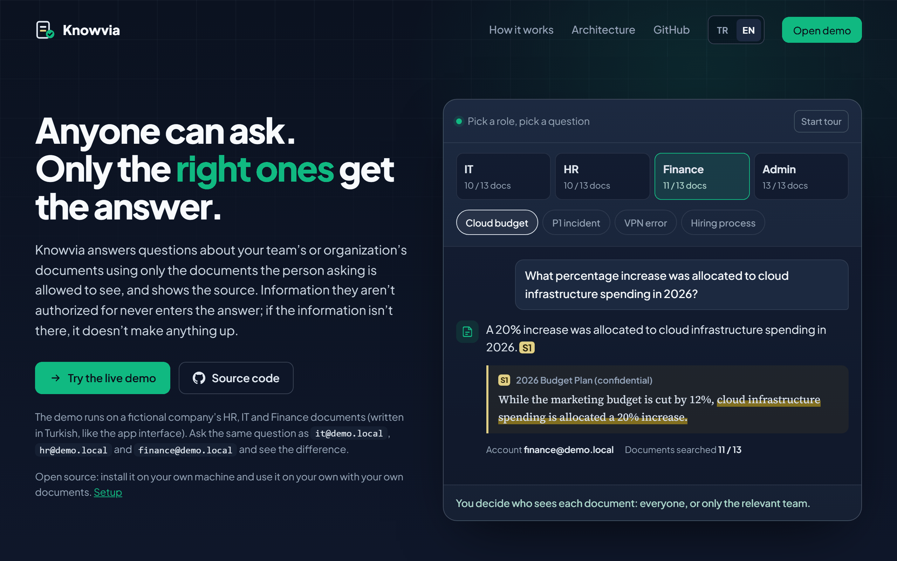

<h1 align="center">Knowvia</h1>

<p align="center"><b>Anyone can ask. Only the right ones get the answer.</b></p>
<p align="center">An access-aware RAG knowledge assistant with cited answers for team and company documents.</p>

<p align="center">
  <a href="https://knowvia.duckdns.org"></a>
  
  
  
  
</p>

<p align="center">
  <a href="https://knowvia.duckdns.org/app/"><b>Live demo</b></a> ·
  <a href="https://knowvia.duckdns.org"><b>Project page</b></a> ·
  <a href="README.md"><b>Türkçe</b></a>
</p>

<p align="center">
  <a href="#try-it-yourself">Try it</a> ·
  <a href="#what-it-does">What it does</a> ·
  <a href="#how-a-question-is-answered">Architecture</a> ·
  <a href="#results">Results</a> ·
  <a href="#run-it-locally">Run locally</a> ·
  <a href="#lessons-from-building-it">Lessons</a>
</p>



An access-aware RAG knowledge assistant. People ask questions about their team's or organization's documents in plain language; every answer is built **only from the documents that person is allowed to see**, with the sources shown. If the information is missing, or the person has no access to it, Knowvia says so with the same refusal instead of guessing.

> [!TIP]
> The fastest way to try it: open [knowvia.duckdns.org](https://knowvia.duckdns.org) and press **Try the live demo**. The member accounts and password are listed on the login screen; ask the same question as Finance and as IT and compare.

> [!NOTE]
> The demo runs on a fictional company's synthetic HR, IT and Finance documents; no real company data is involved. The interface and documents are in Turkish.


## Try it yourself

Sign in with different accounts and ask the same questions (the demo is in Turkish). ✅ means a cited answer, — means the same refusal.

| Question | IT | HR | Finance | What it shows |
|---|:-:|:-:|:-:|---|
| *2026 yılında bulut altyapı harcamalarına yüzde kaç artış ayrıldı?*<br>What increase was allocated to cloud infrastructure in 2026? | — | — | ✅ 20% | A Finance-only document stays invisible to everyone else |
| *Bir P1 olayında kriz ekibi kaç dakika içinde toplanmalı?*<br>How fast must the crisis team meet for a P1 incident? | ✅ 30 min | — | — | The same rule for an IT-only incident plan |
| *Yazılım mühendisi işe alım süreci kaç aşamalı?*<br>How many stages does engineering hiring have? | — | ✅ 4 | — | The same rule for a confidential HR guide |
| *VPN sertifika doğrulanamadı hatası veriyor, ne yapmalıyım?*<br>The VPN says the certificate could not be verified. | ✅ | ✅ | ✅ | Company-wide documents answer everyone |
| *Haftada kaç gün uzaktan çalışabilirim?*<br>How many days a week can I work remotely? | ✅ 3 | ✅ 3 | ✅ 3 | The 2026 policy wins over the archived 2024 one |
| *Şirketin 2027 bütçesi ne kadar?*<br>What is the company's 2027 budget? | — | — | — | Not in any document: no guessing, even for Finance |

Then reply *"Saati ve önbelleği denedim ama hâlâ bağlanamıyorum. Destek talebi açar mısın?"* ("I checked the clock and the cache but still can't connect. Can you open a ticket?") after the VPN answer: the model drafts a ticket, and nothing is saved until you confirm it.


## What it does

| Capability | What you get |
|---|---|
| **Access control** | Each document is visible company-wide or to one department. Role and department come from the database on every request, never from the token or the client, and the check runs twice: as a filter inside the vector search and again on every returned chunk. Anything unclear fails closed. |
| **Cited answers** | Answers come only from authorized chunks and cite them as `[S1]`, `[S2]`; each source card shows the file, page and excerpt. Citations the model invents are removed before the answer is shown. |
| **One refusal** | "No information" and "no permission" return the same text, so a refusal never reveals that a hidden document exists. Chunks below a measured similarity threshold never reach the model. |
| **Hybrid search** | Dense multilingual embeddings (`multilingual-e5-large`) plus BM25 keyword search with a Turkish stemmer, fused with Reciprocal Rank Fusion. Form codes, port numbers and product names are found even when the meaning-based search misses them. |
| **GPU re-ranking** *(optional)* | With `GPU_ENABLED=true`, 20 candidates are re-ordered by a cross-encoder (`bge-reranker-v2-m3`, ONNX on CUDA): about 0.3 s per question on an RTX 4050 instead of about 14 s on CPU. |
| **Conversations** | Follow-up questions such as "what if that doesn't work?" are resolved with server-side history. Sources behind earlier answers are re-authorized every turn; an answer whose document was revoked is hidden and never sent to the model again. |
| **Support tickets** | When the documented steps do not solve the problem, the model proposes a ticket draft through tool calling. The ticket is created only after the user reviews and confirms it. |
| **Document management** | Admins upload PDF, TXT and Markdown files (up to 10 MB). Text is split per paragraph, embedded and indexed. Deleting a document revokes access first and cleans up vectors afterwards. |
| **Public demo hardening** | JWT sessions with Argon2 password hashes, per-user, per-account and global rate limits (HTTP 429 with `Retry-After`), a separate admin password and a nightly reset of visitor data. |

**Stack:** Python, FastAPI, SQLAlchemy and SQLite, Qdrant (local mode), FastEmbed, Streamlit, an OpenAI-compatible LLM API (Groq `openai/gpt-oss-120b` by default), Docker and Caddy.

## How a question is answered

<picture>
  <source media="(prefers-color-scheme: dark)" srcset="docs/assets/architecture-dark.svg">
  
</picture>

1. **Identify.** The JWT is verified, then role and department are loaded from SQLite. A client that claims to be an admin changes nothing.
2. **Allowlist.** The IDs of documents this user may read are listed. If the list is empty, the search does not run at all.
3. **Hybrid search.** Qdrant runs the dense and the BM25 search, each restricted to the allowlist, and fuses the rankings.
4. **Re-check.** Every returned chunk is checked against SQLite again, and chunks below the similarity threshold are dropped. With a GPU, the remaining candidates are re-ranked here.
5. **Grounded generation.** Only the surviving chunks are sent to the LLM, wrapped as quoted sources. A document cannot close its source tag to inject instructions.
6. **Verify.** Citations are validated. The user gets a cited answer, or the same refusal as for missing information.

Permissions are never stored in Qdrant: SQLite is the single source of truth, and Qdrant only narrows the search. The diagram is generated by [`scripts/draw_architecture.py`](scripts/draw_architecture.py).

## Results

Every number below was measured in this repository; the scripts and data are under `scripts/` and `eval/`, and the decisions are recorded in [ADRs](docs/adr/README.md).

**Retrieval on doc2dial** (IBM, CC BY 3.0; DMV domain, 149 English documents, 908 real follow-up turns):

| Configuration | Right document first | Right document in top 5 | Answer passage in top 5 |
|---|---:|---:|---:|
| Dense only | 66.5% | 85.1% | 62.8% |
| Hybrid (default) | 71.7% | 92.8% | 67.4% |
| Hybrid + GPU re-ranking | **78.6%** | **93.7%** | **75.5%** |

**End-to-end on the Turkish demo set** (real LLM, 22 questions across four users): recall@5 16/16, answer facts covered 16/16, correct refusals 22/22, correct citations 22/22, **0 access leaks**. Average retrieval time 61 ms.

**Follow-up conversations** (21 synthetic scenarios, 23 follow-up turns, including elliptical questions, topic switches and permission traps): answer facts 18/18, correct sources 18/18, correct refusals 22/23, **0 access leaks**. The one miss was a generalization not supported by the documents, not a leak.

What was tried and rejected is recorded too: a longer history window (right document first fell from 100% to 47% in mixed-topic conversations) and adding titles to chunks (no gain). See [ADR-08](docs/adr/08-server-owned-conversation-context.md), [ADR-10](docs/adr/10-reranking-measured-and-deferred.md) and [ADR-11](docs/adr/11-hybrid-search-and-gpu-reranking.md).

These are small or domain-specific sets measured on local hardware; they describe this project, not a general accuracy guarantee.

## Run it locally

Requires Python 3.11+ and [uv](https://docs.astral.sh/uv/). The commands are for Windows PowerShell; run them from the project root.

```powershell
uv sync --locked
Copy-Item .env.example .env   # first setup only; do not overwrite your settings
```

Edit `.env`:

| Setting | Value |
|---|---|
| `DEMO_USER_PASSWORD` | A shared password for the demo accounts |
| `JWT_SECRET_KEY` | At least 32 random characters: `uv run python -c "import secrets; print(secrets.token_urlsafe(32))"` |
| `LLM_API_KEY` | Your provider's key; set `LLM_BASE_URL` and `LLM_MODEL` too (the example uses Groq) |
| `ADMIN_PASSWORD` | Optional: a separate admin password (required for a public deployment) |

> [!IMPORTANT]
> Never share `.env` or `data/runtime/`. Document chunks are sent to the LLM provider you configure, so use synthetic data.

Seed the demo users and documents **while the API is stopped** (the embedding model, about 2.3 GB, is downloaded on the first run):

```powershell
uv run python -m scripts.seed_users
uv run python -m scripts.seed_demo_documents
```

Start the API and the interface in two terminals:

```powershell
uv run uvicorn app.main:app --reload
uv run streamlit run frontend/streamlit_app.py
```

The app runs at http://localhost:8501 and the API docs at http://127.0.0.1:8000/docs.

> [!WARNING]
> Qdrant local mode allows one process per data folder. Do not seed while the API is running and do not start several API workers.

| Account | Can read |
|---|---|
| `admin@demo.local` | All active documents; uploads and deletes |
| `it@demo.local` | Company-wide and IT documents |
| `hr@demo.local` | Company-wide and HR documents |
| `finance@demo.local` | Company-wide and Finance documents |

Then try the questions from [Try it yourself](#try-it-yourself).

<details>
<summary><b>GPU re-ranking (optional, NVIDIA)</b></summary>

1. Update the driver; `nvidia-smi` should show **CUDA 13** or later. The CUDA Toolkit is not needed.
2. Build the separate GPU environment (`onnxruntime-gpu` cannot live next to the CPU build):

   ```powershell
   powershell -ExecutionPolicy Bypass -File scripts\setup_gpu_env.ps1
   ```

3. Set `GPU_ENABLED=true` in `.env` and start the API with that environment:

   ```powershell
   .\.venv-gpu\Scripts\python.exe -m uvicorn app.main:app
   ```

If `GPU_ENABLED=true` but CUDA is missing, chat returns a 503 with setup instructions instead of silently running slowly. The model (about 1.1 GB) is downloaded on the first question.

</details>

<details>
<summary><b>Upgrading from an older install</b></summary>

The search schema moved to hybrid vectors (`knowledge_chunks_v2`). With the API stopped, copy the old vectors; the embedding model does not run again and the old collection stays for rollback:

```powershell
uv run python -m scripts.reindex_hybrid --source knowledge_chunks_v1
```

Then make sure `.env` contains `QDRANT_COLLECTION=knowledge_chunks_v2`.

</details>

## Deploy

One container runs the API and the interface; Caddy in front provides automatic HTTPS, serves the project page at `/` and proxies the app at `/app/`. The image builds for ARM (Oracle Ampere) and x86_64.

```bash
docker compose up -d --build
```

The live demo runs this setup on Oracle Cloud Always Free without a GPU, so it uses hybrid search without re-ranking. Step-by-step guide: [docs/deploy-oracle.md](docs/deploy-oracle.md). Decisions: [ADR-12](docs/adr/12-public-demo-deployment.md).

## Tests and evaluation

```powershell
uv run pytest -q
```

The test suite uses fake embeddings and a mocked LLM, so it needs no API key; tests that need the real embedding model are skipped when the model is not cached. The suite covers access control end to end (department isolation through `/chat`, client-side role spoofing, revocation during deletion), uniform refusals, prompt injection, citation handling, rate limits and the UI.

The evaluations call the real LLM provider and write results under `eval/results/`:

```powershell
uv run python -m scripts.rag_eval        # Turkish demo set
uv run python -m scripts.followup_eval   # follow-up conversations
uv run python -m scripts.doc2dial_eval   # doc2dial retrieval (dataset downloaded separately)
```

## Project layout

```text
app/
  api/            FastAPI routes: auth, chat, conversations, documents, tickets, rate limits
  services/       retrieval, authorization, chunking, prompts, LLM, re-ranker, ingest, deletion
  repositories/   Qdrant vector store (dense + BM25 named vectors)
  db/, schemas/   SQLAlchemy models and API schemas
frontend/         Streamlit app (chat, documents, tickets) and its assets
scripts/          seeding, evaluation, reindexing, demo reset, diagram generation
eval/             evaluation questions and conversations
docs/             project page (index.html), ADRs, deployment guide, images
deploy/, docker/  Caddyfile and container entrypoint
```

## Limitations

- Single-node by design: one process, SQLite and Qdrant local mode; no SSO or multi-tenancy yet.
- Scanned PDFs (OCR), DOCX and images are not supported.
- Support tickets stay in SQLite and are not sent to a real help desk; the ticket proposal needs a provider that supports tool calling.
- Deleting a document hides answers that relied on it, but their text stays in SQLite; there is no conversation deletion or retention policy yet.

## Lessons from building it

Each decision below is an ADR with the alternatives that were considered and the evidence behind the choice.

- **Authority belongs in the database, not the token.** The JWT carries only the user ID and expiry; role and department are read on every request, so a permission change takes effect immediately and a forged claim is worthless. [ADR-04](docs/adr/04-jwt-authentication.md)
- **Chunking mattered more than the model.** Greedy merging packed unrelated paragraphs together and put the right document first for only 68% of answerable questions; one paragraph per chunk raised that to 87%. [ADR-06](docs/adr/06-own-text-splitter.md), [ADR-07](docs/adr/07-paragraph-chunking-and-threshold.md)
- **A refusal threshold has to be measured.** The 0.80 cosine threshold was chosen on 424 observations: 97% of answerable questions pass, while 60% of unanswerable ones are stopped before any LLM call. The model's own "insufficient context" check handles the rest. [ADR-07](docs/adr/07-paragraph-chunking-and-threshold.md)
- **An answer can leak through context it did not cite.** Each assistant message stores every document it was shown, not only the cited ones, and those are re-authorized before the answer is reused in a follow-up. [ADR-08](docs/adr/08-server-owned-conversation-context.md)
- **A model may suggest an action, not take it.** Ticket creation is a tool the model can only propose; the write happens after the user confirms. [ADR-09](docs/adr/09-support-ticket-propose-then-confirm.md)
- **Measure before adding complexity.** Re-ranking was measured first and deferred because it took about 14 s on CPU, then shipped behind a GPU switch; hybrid search was cheap enough to enable everywhere. [ADR-10](docs/adr/10-reranking-measured-and-deferred.md), [ADR-11](docs/adr/11-hybrid-search-and-gpu-reranking.md)
- **Going public changes the threat model.** A shared admin password, one visitor exhausting the LLM quota and accumulating visitor data were each addressed before launch: a separate admin secret, rate limits keyed by user because the API never sees visitor IPs, and a nightly reset. [ADR-12](docs/adr/12-public-demo-deployment.md)

The rest, from package management to password hashing and the embedding benchmark, is in [docs/adr](docs/adr/README.md).
