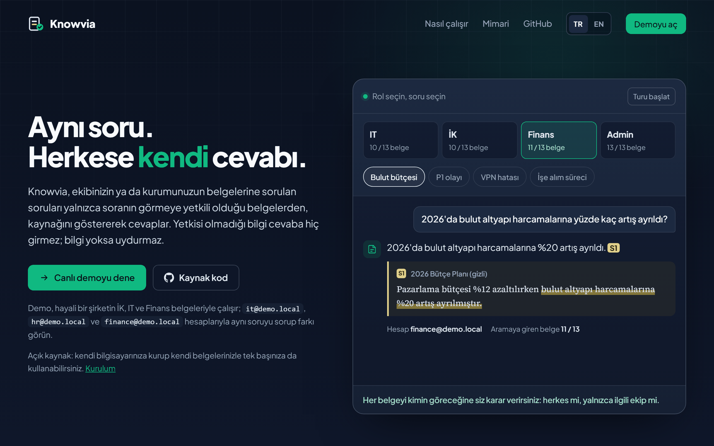
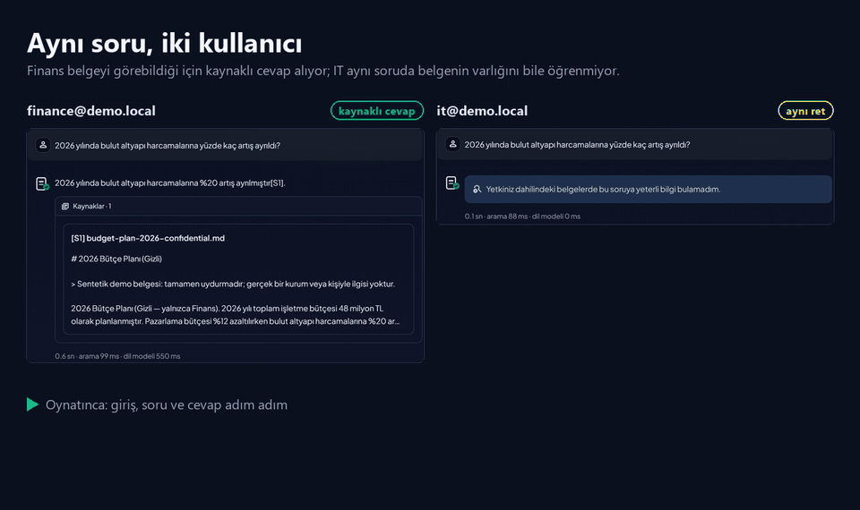
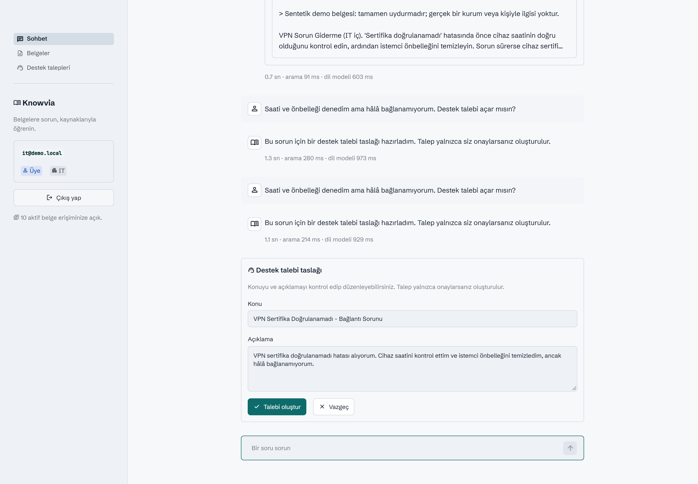
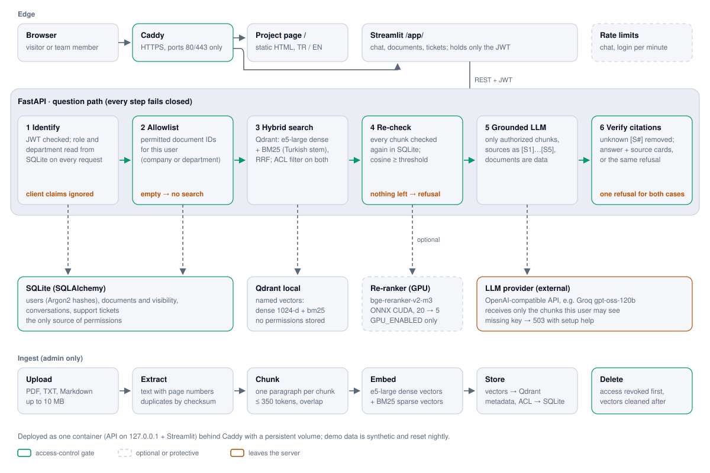

<h1 align="center">Knowvia</h1>

<p align="center"><b>Herkes aynı soruyu sorabilir. Cevabı yalnızca görmeye yetkili olan alır.</b></p>
<p align="center">Ekip ve kurum belgeleri için erişim yetkisine duyarlı, kaynak gösteren RAG bilgi asistanı.</p>

<p align="center">
  <a href="https://knowvia.duckdns.org"></a>
  
  
  
  
</p>

<p align="center">
  <a href="https://knowvia.duckdns.org/app/"><b>Canlı demo</b></a> ·
  <a href="https://knowvia.duckdns.org"><b>Tanıtım sayfası</b></a> ·
  <a href="README.en.md"><b>English</b></a>
</p>

<p align="center">
  <a href="#kendiniz-deneyin">Kendiniz deneyin</a> ·
  <a href="#neler-yapıyor">Neler yapıyor?</a> ·
  <a href="#bir-soru-nasıl-cevaplanıyor">Mimari</a> ·
  <a href="#ölçülen-sonuçlar">Ölçülen sonuçlar</a> ·
  <a href="#yerelde-çalıştırma">Kurulum</a> ·
  <a href="#geliştirirken-öğrendiklerim">Öğrendiklerim</a>
</p>



Knowvia, ekiplerin ve kurumların kendi belgelerine doğal dille soru sorabildiği, erişim yetkisini her adımda gözeten bir RAG bilgi asistanıdır. Cevap **yalnızca soranın görmeye yetkili olduğu belgelerden** çıkar ve kaynağıyla birlikte gelir. Bilgi belgelerde yoksa ya da kişinin o bilgiye erişimi yoksa Knowvia tahmin yürütmez; her iki durumda da aynı cevabı verir.

> [!TIP]
> En hızlı deneme yolu: [knowvia.duckdns.org](https://knowvia.duckdns.org) adresinde **Canlı demoyu dene** düğmesine basın. Demo hesapları ve parolası giriş ekranında yazar; aynı soruyu Finans ve IT hesaplarıyla sorup farkı görün.

> [!NOTE]
> Demo, hayali bir şirketin İK, IT ve Finans birimlerine ait sentetik belgelerle çalışır; gerçek bir kuruma ait veri içermez.



## Kendiniz deneyin

Farklı hesaplarla giriş yapıp aynı soruları sorun. ✅ kaynaklı cevabı, — herkese verilen aynı ret cevabını gösterir.

| Soru | IT | İK | Finans | Neyi gösteriyor? |
|---|:-:|:-:|:-:|---|
| *2026 yılında bulut altyapı harcamalarına yüzde kaç artış ayrıldı?* | — | — | ✅ %20 | Finans'a özel belge diğer birimlere hiç görünmez |
| *Bir P1 olayında kriz ekibi kaç dakika içinde toplanmalı?* | ✅ 30 dk | — | — | Aynı kural, IT'ye özel olay müdahale planında da işler |
| *Yazılım mühendisi işe alım süreci kaç aşamalı?* | — | ✅ 4 | — | İK'nın gizli işe alım rehberi yalnızca İK'ya açıktır |
| *VPN sertifika doğrulanamadı hatası veriyor, ne yapmalıyım?* | ✅ | ✅ | ✅ | Şirket geneline açık belgeler herkese cevap verir |
| *Haftada kaç gün uzaktan çalışabilirim?* | ✅ 3 | ✅ 3 | ✅ 3 | Yürürlükteki 2026 politikası, arşivdeki 2024 sürümünün önüne geçer |
| *Şirketin 2027 bütçesi ne kadar?* | — | — | — | Hiçbir belgede yok: Finans dahil kimseye tahmin sunulmaz |

VPN cevabının ardından *"Saati ve önbelleği denedim ama hâlâ bağlanamıyorum. Destek talebi açar mısın?"* yazın: model bir talep taslağı hazırlar, siz onaylamadan hiçbir kayıt oluşmaz.



## Neler yapıyor?

| Yetenek | Ne sağlıyor? |
|---|---|
| **Erişim kontrolü** | Her belge ya tüm şirkete ya da tek bir birime açıktır. Kullanıcının rolü ve birimi her istekte veritabanından okunur; token'daki ya da tarayıcıdan gelen bilgiye güvenilmez. Yetki iki kez denetlenir: önce vektör aramasının içinde, ardından dönen her parçada. Şüpheli her durumda kapı kapalı kalır. |
| **Kaynak gösteren cevaplar** | Cevaplar yalnızca yetkili parçalardan üretilir ve `[S1]`, `[S2]` biçiminde kaynağını gösterir; kaynak kartında dosya adı, sayfa ve alıntı yer alır. Modelin uydurduğu kaynak etiketleri, cevap ekrana gelmeden silinir. |
| **Tek tip ret** | "Bilgi yok" ile "yetkiniz yok" aynı cümleyle karşılanır; böylece ret, gizli bir belgenin varlığını ele vermez. Soruyla yeterince örtüşmeyen parçalar ölçülerek belirlenmiş bir eşikte elenir ve modele hiç ulaşmaz. |
| **Hibrit arama** | Anlama dayalı çok dilli arama (`multilingual-e5-large`) ile Türkçe kök bulma destekli BM25 kelime araması birlikte çalışır, sonuçlar Reciprocal Rank Fusion ile birleştirilir. Form kodu, port numarası ya da ürün adı gibi terimler, anlam araması gözden kaçırsa bile bulunur. |
| **GPU ile yeniden sıralama** *(isteğe bağlı)* | `GPU_ENABLED=true` olduğunda en iyi 20 aday, bir çapraz kodlayıcıyla (`bge-reranker-v2-m3`, CUDA üzerinde ONNX) yeniden sıralanır. RTX 4050'de soru başına yaklaşık 0,3 sn sürer; aynı iş CPU'da 14 saniyeyi bulur. |
| **Sohbet hafızası** | "Peki bu da olmazsa?" gibi takip soruları, sunucuda tutulan sohbet geçmişiyle anlaşılır. Önceki cevapların dayandığı belgelerin yetkisi her turda yeniden denetlenir; yetkisi kaldırılan bir cevap gizlenir ve modele bir daha gönderilmez. |
| **Destek talepleri** | Belgedeki adımlar sorunu çözmezse model, araç çağrısıyla (tool calling) bir talep taslağı önerir. Talep, kullanıcı taslağı inceleyip onaylamadan oluşturulmaz. |
| **Belge yönetimi** | Admin; PDF, TXT ve Markdown dosyalarını (en fazla 10 MB) yükler. Metin paragraflara bölünür, vektörlere dönüştürülür ve indekslenir. Silme işleminde önce erişim kesilir, vektörler ardından temizlenir. |
| **Herkese açık demoya karşı önlemler** | Argon2 ile saklanan parolalar ve JWT oturumları; kullanıcı, hesap ve genel düzeyde istek sınırları (`Retry-After` ile HTTP 429); ayrı bir admin parolası ve ziyaretçi verilerinin her gece sıfırlanması. |

**Kullanılan teknolojiler:** Python, FastAPI, SQLAlchemy ve SQLite, Qdrant (local mod), FastEmbed, Streamlit, OpenAI uyumlu bir LLM API'si (varsayılan olarak Groq `openai/gpt-oss-120b`), Docker ve Caddy.

## Bir soru nasıl cevaplanıyor?

<picture>
  <source media="(prefers-color-scheme: dark)" srcset="docs/assets/architecture-dark.svg">
  
</picture>

1. **Soran kişi tanınır.** JWT doğrulanır; rol ve birim SQLite'tan okunur. Kendini admin gibi gösteren bir istemci hiçbir şeyi değiştiremez.
2. **İzinli belgeler belirlenir.** Kullanıcının okuyabileceği belgelerin listesi çıkarılır. Liste boşsa arama hiç başlamaz.
3. **İki yoldan arama yapılır.** Qdrant, anlam ve kelime aramasını yalnızca bu listenin içinde yürütür ve iki sıralamayı birleştirir.
4. **Sonuçlar yeniden denetlenir.** Dönen her parça SQLite'ta bir kez daha kontrol edilir; eşiğin altında kalanlar elenir. GPU varsa kalan adaylar bu aşamada yeniden sıralanır.
5. **Model yalnızca kanıtla konuşur.** LLM'e sadece bu süzgeçten geçen parçalar, alıntı olarak işaretlenmiş şekilde gönderilir. Bir belge, kaynak etiketini kapatıp modele talimat sızdıramaz.
6. **Kaynaklar doğrulanır.** Kaynak etiketleri denetlenir. Kullanıcı ya kaynaklı bir cevap ya da bilgi bulunamamış gibi aynı reddi alır.

Yetki bilgisi Qdrant'a hiç yazılmaz: tek doğru kaynak SQLite'tır, Qdrant yalnızca aramayı daraltır. Diyagram [`scripts/draw_architecture.py`](scripts/draw_architecture.py) ile üretilir.

## Ölçülen sonuçlar

Aşağıdaki her sayı bu depoda ölçüldü. Betikler ve veriler `scripts/` ile `eval/` klasörlerinde, kararların gerekçeleri [ADR'lerde](docs/adr/README.md).

**doc2dial ile arama başarısı** (IBM, CC BY 3.0; DMV alanı, 149 İngilizce belge, 908 gerçek takip sorusu):

| Yapılandırma | Doğru belge ilk sırada | Doğru belge ilk 5'te | Cevabın geçtiği parça ilk 5'te |
|---|---:|---:|---:|
| Yalnızca anlam araması | %66,5 | %85,1 | %62,8 |
| Hibrit (varsayılan) | %71,7 | %92,8 | %67,4 |
| Hibrit + GPU ile yeniden sıralama | **%78,6** | **%93,7** | **%75,5** |

**Türkçe demo setinde uçtan uca** (gerçek LLM, dört kullanıcıya dağılmış 22 soru): ilk 5'te doğru kaynak 16/16, cevapta beklenen bilgiler 16/16, yerinde ret 22/22, doğru kaynak etiketi 22/22 ve **sıfır yetkisiz sızıntı**. Arama süresi ortalama 61 ms.

**Takip soruları** (21 sentetik senaryo, 23 takip turu; eksiltili sorular, konu değişiklikleri ve yetki tuzakları dahil): cevapta beklenen bilgiler 18/18, doğru kaynak 18/18, yerinde ret 22/23 ve **sıfır yetkisiz sızıntı**. Tek hata, belgelerde dayanağı olmayan bir genellemeydi; yetkisiz bilgi sızmadı.

Denenip vazgeçilenler de kayıt altında: geçmiş penceresini uzatmak, konular karıştığında doğru belgenin ilk sırada gelme oranını %100'den %47'ye düşürdü; parçalara başlık eklemek ise bir kazanç sağlamadı. Ayrıntılar: [ADR-08](docs/adr/08-server-owned-conversation-context.md), [ADR-10](docs/adr/10-reranking-measured-and-deferred.md), [ADR-11](docs/adr/11-hybrid-search-and-gpu-reranking.md).

Bu ölçümler küçük ya da belirli bir alana ait veri kümelerinde, yerel donanımda yapıldı; projenin davranışını gösterir, genel bir doğruluk garantisi vermez.

## Yerelde çalıştırma

Python 3.11+ ve [uv](https://docs.astral.sh/uv/) gerekir. Komutlar Windows PowerShell içindir ve proje kökünde çalıştırılır.

```powershell
uv sync --locked
Copy-Item .env.example .env   # yalnızca ilk kurulumda; mevcut ayarlarınızın üzerine yazmayın
```

`.env` dosyasında şunları doldurun:

| Ayar | Değer |
|---|---|
| `DEMO_USER_PASSWORD` | Demo hesaplarının ortak parolası |
| `JWT_SECRET_KEY` | En az 32 karakterlik rastgele bir anahtar: `uv run python -c "import secrets; print(secrets.token_urlsafe(32))"` |
| `LLM_API_KEY` | LLM sağlayıcınızın anahtarı; `LLM_BASE_URL` ve `LLM_MODEL` değerlerini de buna göre ayarlayın (örnek dosya Groq'a göre hazır) |
| `ADMIN_PASSWORD` | İsteğe bağlı, admin için ayrı bir parola (herkese açık kurulumda zorunlu) |

> [!IMPORTANT]
> `.env` dosyasını ve `data/runtime/` klasörünü kimseyle paylaşmayın. Belge parçaları seçtiğiniz LLM sağlayıcısına gönderildiği için yalnızca sentetik veri kullanın.

Demo kullanıcılarını ve belgelerini **API kapalıyken** yükleyin (ilk çalıştırmada yaklaşık 2,3 GB'lık embedding modeli indirilir):

```powershell
uv run python -m scripts.seed_users
uv run python -m scripts.seed_demo_documents
```

Ardından API'yi ve arayüzü iki ayrı terminalde başlatın:

```powershell
uv run uvicorn app.main:app --reload
uv run streamlit run frontend/streamlit_app.py
```

Uygulama http://localhost:8501, API dokümantasyonu http://127.0.0.1:8000/docs adresinde açılır.

> [!WARNING]
> Qdrant local mod bir veri klasörünü aynı anda tek bir süreçte açabilir. API çalışırken seed komutlarını çalıştırmayın ve birden fazla API worker başlatmayın.

| Hesap | Erişebildiği belgeler |
|---|---|
| `admin@demo.local` | Tüm aktif belgeler; yükleme ve silme yetkisi |
| `it@demo.local` | Şirket geneli ve IT belgeleri |
| `hr@demo.local` | Şirket geneli ve İK belgeleri |
| `finance@demo.local` | Şirket geneli ve Finans belgeleri |

Sonra [Kendiniz deneyin](#kendiniz-deneyin) bölümündeki soruları sorun.

<details>
<summary><b>GPU ile yeniden sıralama (isteğe bağlı, NVIDIA)</b></summary>

1. Ekran kartı sürücüsünü güncelleyin; `nvidia-smi` çıktısında **CUDA 13** veya üstü görünmeli. CUDA Toolkit kurmanıza gerek yok.
2. Ayrı GPU ortamını kurun (`onnxruntime-gpu`, CPU sürümüyle aynı ortamda bulunamaz):

   ```powershell
   powershell -ExecutionPolicy Bypass -File scripts\setup_gpu_env.ps1
   ```

3. `.env` içinde `GPU_ENABLED=true` yapın ve API'yi bu ortamla başlatın:

   ```powershell
   .\.venv-gpu\Scripts\python.exe -m uvicorn app.main:app
   ```

`GPU_ENABLED=true` olduğu hâlde CUDA bulunamazsa sohbet sessizce yavaş moda geçmez; kurulumun nasıl tamamlanacağını anlatan bir 503 hatası döner. Model (yaklaşık 1,1 GB) ilk soruda indirilir.

</details>

<details>
<summary><b>Eski bir kurulumu güncelleme</b></summary>

Arama şeması hibrit vektörlere geçti (`knowledge_chunks_v2`). API kapalıyken eski vektörleri yeni koleksiyona taşıyın; embedding modeli yeniden çalışmaz, eski koleksiyon da geri dönüş için yerinde kalır:

```powershell
uv run python -m scripts.reindex_hybrid --source knowledge_chunks_v1
```

Ardından `.env` içinde `QDRANT_COLLECTION=knowledge_chunks_v2` yazdığından emin olun.

</details>

## Sunucuya kurulum

API ve arayüz tek bir konteynerde çalışır. Öndeki Caddy HTTPS sertifikasını kendisi alır, tanıtım sayfasını `/` adresinde sunar ve uygulamayı `/app/` altında yayınlar. İmaj hem ARM (Oracle Ampere) hem x86_64 için derlenir.

```bash
docker compose up -d --build
```

Canlı demo bu kurulumla, GPU'su olmayan bir Oracle Cloud Always Free sunucusunda çalışıyor; bu yüzden hibrit arama açık, yeniden sıralama kapalı. Adım adım rehber: [docs/deploy-oracle.md](docs/deploy-oracle.md). Gerekçeler: [ADR-12](docs/adr/12-public-demo-deployment.md).

## Testler ve ölçümler

```powershell
uv run pytest -q
```

Testler sahte embedding ve taklit (mock) bir LLM kullanır, bu yüzden API anahtarı gerekmez; gerçek embedding modeline ihtiyaç duyan testler, model önbellekte yoksa atlanır. Testler erişim kontrolünü uçtan uca sınar: `/chat` üzerinden birimler arası ayrım, istemcinin rol taklidi, silme sırasında erişimin kesilmesi. Bunlara ek olarak tek tip ret, prompt injection, kaynak etiketleri, istek sınırları ve arayüz de test edilir.

Ölçüm betikleri gerçek LLM sağlayıcısına istek gönderir ve sonuçları `eval/results/` altına yazar:

```powershell
uv run python -m scripts.rag_eval        # Türkçe demo seti
uv run python -m scripts.followup_eval   # takip soruları
uv run python -m scripts.doc2dial_eval   # doc2dial ile arama (veri seti ayrıca indirilir)
```

## Proje yapısı

```text
app/
  api/            FastAPI uçları: giriş, sohbet, konuşmalar, belgeler, talepler, istek sınırları
  services/       arama, yetkilendirme, parçalama, prompt, LLM, yeniden sıralama, yükleme, silme
  repositories/   Qdrant vektör deposu (dense + BM25 adlandırılmış vektörler)
  db/, schemas/   SQLAlchemy modelleri ve API şemaları
frontend/         Streamlit uygulaması (sohbet, belgeler, talepler) ve görselleri
scripts/          veri yükleme, ölçüm, yeniden indeksleme, demo sıfırlama, diyagram üretimi
eval/             ölçüm soruları ve sohbet senaryoları
docs/             tanıtım sayfası (index.html), ADR'ler, kurulum rehberi, görseller
deploy/, docker/  Caddyfile ve konteyner açılış betiği
```

## Bilinen sınırlar

- Bilinçli olarak tek sunuculu tasarlandı: tek süreç, SQLite ve Qdrant local mod; SSO ve çoklu kiracı (multi-tenant) desteği henüz yok.
- Taranmış PDF'ler (OCR), DOCX dosyaları ve görseller işlenmez.
- Destek talepleri SQLite'ta tutulur, gerçek bir yardım masasına iletilmez; talep önerisi için LLM sağlayıcısının tool calling desteklemesi gerekir.
- Silinen bir belgeye dayanan cevaplar gizlenir ama metinleri SQLite'ta kalır; sohbet silme ve saklama süresi politikası henüz yok.

## Geliştirirken öğrendiklerim

Aşağıdaki her karar, değerlendirilen alternatifleri ve dayandığı kanıtlarla birlikte bir ADR (mimari karar kaydı) olarak duruyor.

- **Yetki token'da değil, veritabanında durmalı.** JWT yalnızca kullanıcı kimliğini ve geçerlilik süresini taşır; rol ve birim her istekte yeniden okunur. Böylece yetki değişikliği anında geçerli olur, sahte bir iddia da hiçbir işe yaramaz. [ADR-04](docs/adr/04-jwt-authentication.md)
- **Parçalama, modelden daha belirleyici çıktı.** Paragrafları doldurarak birleştirmek ilgisiz konuları aynı parçaya topladı ve cevabı olan soruların yalnızca %68'inde doğru belgeyi ilk sıraya getirdi; her paragrafı ayrı parça yapmak bu oranı %87'ye çıkardı. [ADR-06](docs/adr/06-own-text-splitter.md), [ADR-07](docs/adr/07-paragraph-chunking-and-threshold.md)
- **Ret eşiği tahminle değil, ölçümle belirlenir.** 0,80 benzerlik eşiği 424 gözlemle seçildi: cevabı olan soruların %97'si geçiyor, cevabı olmayanların %60'ı ise modele hiç ulaşmadan duruyor. Geri kalanı modelin "yeterli bilgi yok" denetimi yakalıyor. [ADR-07](docs/adr/07-paragraph-chunking-and-threshold.md)
- **Bir cevap, kaynak göstermediği bağlamdan da bilgi sızdırabilir.** Bu yüzden her asistan mesajı yalnızca andığı belgeleri değil, gördüğü bütün belgeleri saklar; takip sorusunda o cevap yeniden kullanılmadan önce hepsinin yetkisi denetlenir. [ADR-08](docs/adr/08-server-owned-conversation-context.md)
- **Model bir işlem önerebilir, ama kendi başına yapamaz.** Destek talebi açmak, modelin yalnızca önerebildiği bir araçtır; kayıt, kullanıcı onay verince oluşur. [ADR-09](docs/adr/09-support-ticket-propose-then-confirm.md)
- **Karmaşıklık eklemeden önce ölç.** Yeniden sıralama önce ölçüldü, CPU'da 14 saniye sürdüğü için ertelendi ve sonra bir GPU anahtarının arkasında devreye alındı; hibrit arama ise her yerde açık tutulacak kadar ucuz çıktı. [ADR-10](docs/adr/10-reranking-measured-and-deferred.md), [ADR-11](docs/adr/11-hybrid-search-and-gpu-reranking.md)
- **Herkese açılmak tehdit modelini değiştirir.** Paylaşılan admin parolası, tek bir ziyaretçinin LLM kotasını tüketmesi ve biriken ziyaretçi verisi yayına çıkmadan çözüldü: ayrı bir admin parolası, API ziyaretçinin IP adresini görmediği için kullanıcıya göre işleyen istek sınırları ve her gece sıfırlama. [ADR-12](docs/adr/12-public-demo-deployment.md)

Paket yönetiminden parola özetlemeye, embedding modeli karşılaştırmasına kadar diğer kararlar [docs/adr](docs/adr/README.md) altında.
