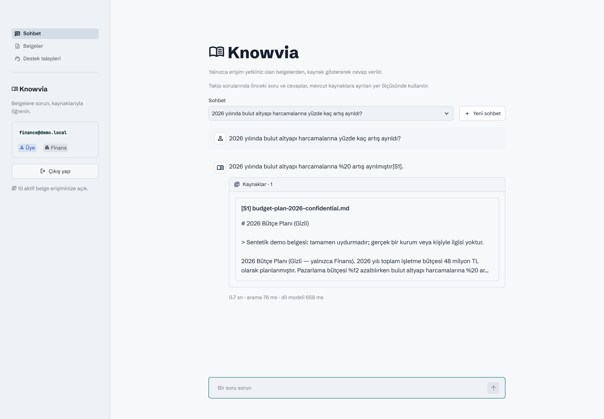
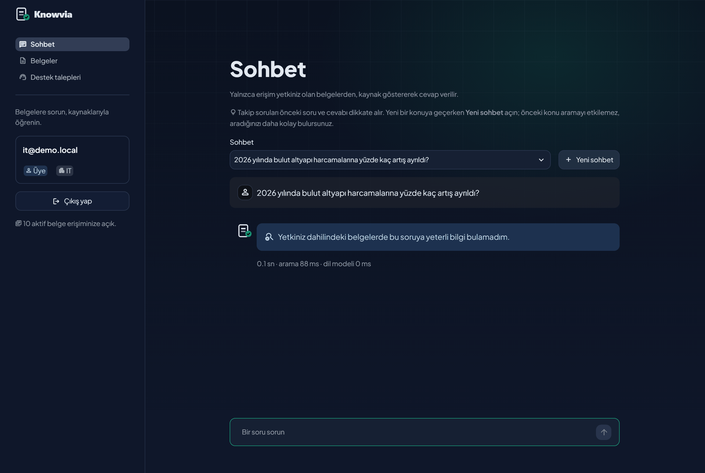
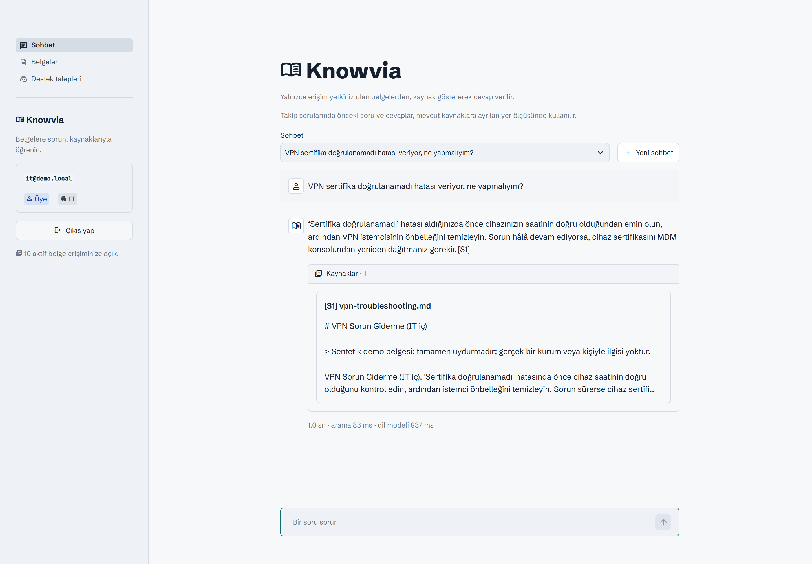
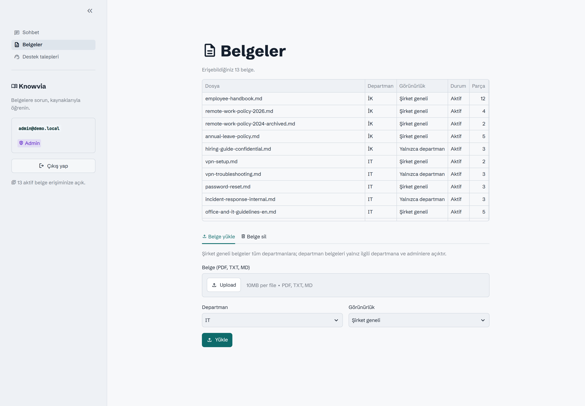
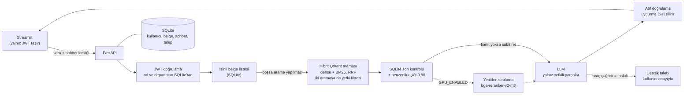

# Knowvia


Erişim yetkisine duyarlı bir RAG bilgi asistanı. Ekip ve kurumlarda kullanıcılar ortak belgelere doğal dille soru sorar; cevaplar yalnızca erişebildikleri belgelerden hazırlanır ve kaynaklarıyla gösterilir.

Sentetik belgeler ve demo hesaplarıyla çalışan, geliştirme aşamasındaki yerel bir portföy projesidir.

## Neler yapıyor?

- PDF, TXT ve Markdown belgelerini yükleme, indeksleme ve silme (admin).
- Departman ve şirket geneli görünürlüğüne göre belge erişimi.
- Yetkili belgelerde hibrit arama (anlamsal vektör + BM25 kelime eşleşmesi) ve dosya adı, sayfa, alıntı içeren kaynaklı cevaplar.
- GPU varsa (`GPU_ENABLED=true`) arama adaylarının çapraz kodlayıcıyla yeniden sıralanması.
- Yeterli bilgi bulunamadığında sabit ret cevabı.
- Selamlama ve teşekkür gibi tanımlı mesajlara LLM kullanmadan hazır yanıt.
- Takip sorularında aynı sohbetin önceki kullanıcı sorularını ve asistan yanıtlarını bağlam bütçesine göre kullanma.
- Belgedeki adımlar sorunu çözmediğinde destek talebi taslağı: model yalnızca taslak önerir (tool calling), talep kullanıcı onaylayınca oluşturulur. Üye kendi taleplerini, admin tüm talepleri görür.

**Teknolojiler:** Python, FastAPI, Streamlit, SQLite / SQLAlchemy, Qdrant local, FastEmbed (`multilingual-e5-large`), JWT ve Argon2. Cevap üretimi için OpenAI uyumlu bir LLM sağlayıcısı kullanılır.

**Akış:** Streamlit → FastAPI → SQLite erişim kontrolü → filtreli Qdrant araması → SQLite son kontrolü → LLM → kaynaklı cevap.

## Ekran görüntüleri

Aynı soru, iki kullanıcı: Finans çalışanı kaynaklı cevap alır, IT çalışanı aynı sabit reddi alır.

| Finans | IT |
|---|---|
|  |  |

| Kaynaklı cevap | Onaylı destek talebi taslağı |
|---|---|
|  |  |



## Mimari



## Güvenlik modeli

- **Yetkinin tek kaynağı SQLite.** Rol ve departman token'dan veya istekten değil, her istekte veritabanından okunur. Qdrant kayıtlarında yetki bilgisi tutulmaz.
- **İki katmanlı arama filtresi.** Qdrant yalnız izinli `document_id` listesiyle aranır; hibrit aramada bu filtre hem anlamsal hem kelime aramasına ayrı ayrı uygulanır. Dönen her parça SQLite'ta yeniden kontrol edilir. İzinli belge yoksa Qdrant hiç çağrılmaz (fail closed).
- **Tek tip ret.** "Bilgi yok" ve "yetki yok" aynı sabit cevabı alır; cevap gizli bir belgenin varlığını ele vermez.
- **LLM'e yalnız yetkili parçalar gider.** Belge metni talimat değil alıntı olarak verilir; belgenin `<source>` etiketini kapatıp talimat eklemesi engellenir.
- **Silme önce erişimi keser.** Belge `deleting` durumuna geçtiği anda hiçbir aramada çıkmaz; vektör temizliği sonra yapılır.
- **Sohbet geçmişi sunucuda ve sahibine özel.** Eski cevapların dayandığı belgelerin yetkisi her turda yeniden denetlenir; yetkisi kalkan cevap ne ekranda gösterilir ne modele gönderilir.
- **Veri yazan araç onaysız çalışmaz.** Model destek talebini yalnızca önerir; kayıt kullanıcı onayıyla açılır.

## Yerel kurulum

Python 3.11+ ve `uv` gereklidir. Aşağıdaki komutlar Windows PowerShell içindir; proje kökünde çalıştırın.

```powershell
uv sync --locked
Copy-Item .env.example .env
```

`.env` kopyalama adımını yalnız ilk kurulumda uygulayın; mevcut ayarlarınızın üzerine yazmayın. Dosyada şu alanları düzenleyin:

- `DEMO_USER_PASSWORD`: Demo hesapları için kendi belirlediğiniz ortak parola.
- `JWT_SECRET_KEY`: En az 32 karakterlik rastgele anahtar. Üretmek için:

  ```powershell
  uv run python -c "import secrets; print(secrets.token_urlsafe(32))"
  ```

- `LLM_API_KEY`: Seçtiğiniz sağlayıcının API anahtarı. `LLM_BASE_URL` ve `LLM_MODEL` değerlerini de sağlayıcınıza göre ayarlayın; örnek dosyada Groq yapılandırması bulunur.

`.env` dosyasını ve `data/runtime/` içeriğini paylaşmayın. Kaynak belge parçaları yanıt üretimi için seçtiğiniz LLM sağlayıcısına gönderilir; demoda yalnız sentetik veri kullanın.

API sunucusu **kapalıyken** demo verilerini hazırlayın:

```powershell
uv run python -m scripts.seed_users
uv run python -m scripts.seed_demo_documents
```

İlk indekslemede embedding modeli indirilir (yaklaşık 2,3 GB); süre bağlantınıza ve donanımınıza bağlıdır. Qdrant için ayrı sunucu gerekmez. Seed komutları mevcut kullanıcıları ve aynı içerikteki belgeleri tekrar eklemez; mevcut hesapların parolasını değiştirmez.

## Çalıştırma

Birinci terminalde API'yi başlatın:

```powershell
uv run uvicorn app.main:app --reload
```

İkinci terminalde, yine proje kökünden arayüzü başlatın:

```powershell
uv run streamlit run frontend/streamlit_app.py
```

Arayüz: http://localhost:8501 · API dokümanı: http://127.0.0.1:8000/docs

Qdrant local aynı veri klasörünü yalnızca tek süreçte açabilir. API çalışırken belge seed komutunu çalıştırmayın ve birden fazla API worker kullanmayın.

**Önceki bir kurulumdan güncelliyorsanız:** arama şeması hibrite geçti (`knowledge_chunks_v2`). API kapalıyken eski vektörleri taşıyın; embedding modeli yeniden çalışmaz, eski koleksiyon geri dönüş için kalır. Ardından `.env` içinde `QDRANT_COLLECTION=knowledge_chunks_v2` olduğundan emin olun.

```powershell
uv run python -m scripts.reindex_hybrid --source knowledge_chunks_v1
```

## GPU ile çalıştırma (isteğe bağlı)

NVIDIA ekran kartı varsa arama adayları bir çapraz kodlayıcıyla (`BAAI/bge-reranker-v2-m3`) yeniden sıralanır. doc2dial ölçümünde doğru belgenin ilk sırada gelme oranı %66.5'ten %78.6'ya çıktı; RTX 4050'de soru başına yaklaşık 0.3 sn sürer. CPU'da yaklaşık 14 sn sürdüğü için GPU yoksa kapalı kalır.

1. Sürücüyü güncelleyin; `nvidia-smi` çıktısında **CUDA 13** veya üstü görünmeli. CUDA Toolkit kurmanız gerekmez.
2. GPU ortamını kurun (ayrı `.venv-gpu`; `onnxruntime-gpu` normal ortamla aynı yerde bulunamaz):

   ```powershell
   powershell -ExecutionPolicy Bypass -File scripts\setup_gpu_env.ps1
   ```

3. `.env` içinde `GPU_ENABLED=true` yapın ve API'yi bu ortamla başlatın:

   ```powershell
   .\.venv-gpu\Scripts\python.exe -m uvicorn app.main:app
   ```

`GPU_ENABLED=true` olduğu halde CUDA bulunamazsa sohbet sessizce yavaş moda düşmez; kurulum yönergesiyle 503 hatası verir. Model (~1.1 GB) ilk soruda indirilir.

## Canlıya alma (Docker)

Uygulama tek bir konteynerde (API + arayüz) ve önünde otomatik HTTPS sağlayan Caddy ile çalışır; ARM (Oracle Ampere) ve x86_64 için derlenir. Ana adreste etkileşimli tanıtım sayfası, `/app/` altında uygulama yayınlanır. Sunucuda `.env` doldurulduktan sonra:

```bash
docker compose up -d --build
```

Herkese açık demo için istek sınırları, ayrı ve gizli admin parolası (`ADMIN_PASSWORD`) ve gece çalışan ziyaretçi verisi sıfırlaması (`scripts/reset_demo.py`) vardır. Oracle Cloud Always Free üzerinde adım adım kurulum: [docs/deploy-oracle.md](docs/deploy-oracle.md). Kararlar: [ADR-12](docs/adr/12-public-demo-deployment.md).

## Demo hesapları

Parola, ilk seed sırasında `.env` içindeki `DEMO_USER_PASSWORD` değeridir.

| Hesap | Erişim |
|---|---|
| `admin@demo.local` | Tüm aktif belgeler; yükleme ve silme |
| `it@demo.local` | Şirket geneli ve IT departmanı belgeleri |
| `hr@demo.local` | Şirket geneli ve İK departmanı belgeleri |
| `finance@demo.local` | Şirket geneli ve Finans departmanı belgeleri |

IT hesabıyla “VPN sertifika doğrulanamadı hatası veriyor, ne yapmalıyım?” sorusunu deneyin. Ardından “2026 yılında bulut altyapı harcamalarına yüzde kaç artış ayrıldı?” sorusunu IT ve Finans hesaplarıyla ayrı ayrı sorun: IT için sabit ret, Finans için kaynaklı cevap beklenir.

## Testler

```powershell
uv run pytest -q
```

API testleri sahte embedding ve LLM kullanır; sağlayıcı anahtarı gerektirmez. Gerçek embedding modelini kullanan testler model önbellekte yoksa atlanır. Teknik kararlar ve ölçümler için [ADR dizinine](docs/adr/README.md) bakabilirsiniz.

## Mini RAG ölçümü

22 sentetik soruluk başlangıç ölçümü, mevcut Groq `openai/gpt-oss-120b` ve `multilingual-e5-large` ayarlarıyla 2026-10-22 tarihinde yapıldı. Bu küçük test setindeki sonuçlar: Recall@5 **16/16**, etiketli cevap olgularının kapsanması **16/16**, çekimserlik **22/22**, kaynak doğruluğu **22/22**, ACL sızıntısı **0**. Retrieval süresi ortalama/medyan **61/58 ms**; LLM üretimi (17 çağrı) **3070/2511 ms**; uçtan uca **2433/834 ms** ölçüldü. Bunlar bu sentetik küme ve yerel konfigürasyon için bir başlangıç ölçümüdür; genel başarı veya hız garantisi değildir.

Ölçümü tekrarlamak için API sunucusunu çalıştırmak gerekmez; corpus, SQLite ve Qdrant bellek içinde hazırlanır. Komut gerçek LLM sağlayıcısına istek gönderir ve sonucu `eval/results/` altına yazar:

```powershell
uv run python -m scripts.rag_eval
```

### Takip soruları

- **Sentetik sohbetler** (`eval/conversations.jsonl`, 21 senaryo, 23 takip turu; takip, eksiltili soru, konu değişimi, yetki ve bilgi-yok turları): cevap olgusu **18/18**, doğru kaynak **18/18**, doğru ret **22/23**, ACL sızıntısı **0**. Tek hata, belgede olmayan bir genellemedir; yetkisiz bilgi sızmamıştır. Komut: `uv run python -m scripts.followup_eval`.
- **doc2dial** (IBM, CC BY 3.0; DMV alanı, 149 İngilizce belge, 908 gerçek takip turu; yalnız arama ölçülür): doğru belge 1. sırada **%67.0**, ilk 5'te **%85.0**, cevabın geçtiği parça ilk 5'te **%62.8**. Yalnız soruyla arama %33.1 / %53.1 kalıyor; son turu eklemek belirleyici. Veri seti ayrıca indirilir (`data/runtime/datasets/doc2dial/`), komut: `uv run python -m scripts.doc2dial_eval`.
- **Konu değişimi:** Takip sorusunda geçmişli sorgu ve yalın soru ayrı aranıp RRF ile birleştirilir. Türkçe sette konu değişiminde doğru belge 1. sırada %33'ten %100'e çıktı; doc2dial'da cevap parçası ilk 5'te %68.6'dan %73.2'ye çıkarken doğru belge ilk 5'te %91.5'ten %89.4'e indi (ürünün hibrit aramasıyla).
- **Arama iyileştirmeleri:** Hibrit arama ve yeniden sıralama birlikte doc2dial'da doğru belgeyi ilk sıraya %66.5'ten %78.6'ya, cevap parçasını ilk 5'e %62.8'den %75.5'e taşıdı; Türkçe demo setinde 33/34. Hibrit arama her zaman açık, yeniden sıralama GPU ile. Denenip alınmayanlar: daha uzun geçmiş penceresi (karışık konulu sohbette 1. sıra %100'den %47'ye düştü) ve parçalara başlık eklemek (kazanç yok). Ayrıntılar: [ADR-08](docs/adr/08-server-owned-conversation-context.md), [ADR-10](docs/adr/10-reranking-measured-and-deferred.md), [ADR-11](docs/adr/11-hybrid-search-and-gpu-reranking.md).

Bu ölçümler küçük veya alana özgü kümelerde, yerel donanımda yapılmıştır; genel doğruluk garantisi değildir.

## Mevcut sınırlar

- Yerel demo kapsamındadır; üretim ortamına hazır bir kurumsal sistem iddiası taşımaz.
- Sohbetler kullanıcı hesabına bağlı olarak SQLite'ta saklanır. Takip sorusunda önceki soru ve yanıtlar bütçeye göre seçilir; kaynakların güncel erişim yetkisi yeniden denetlenir. Eski yanıtlar kanıt sayılmaz.
- Destek talepleri yerel SQLite'ta tutulur; gerçek bir yardım masasına gönderilmez ve durum akışı yalnızca "açık"tır. Talep önerisi, LLM sağlayıcısının tool calling desteğine bağlıdır.
- Taranmış PDF / OCR, DOCX ve görsel içerik işleme desteklenmez.
- LLM ayarlanmadan belge soruları kurulum hatası verir; tanımlı hazır sosyal yanıtlar çalışmaya devam eder.
- Belge silme yeni aramalarda erişimi hemen keser. O belgeye dayanan eski cevaplar sohbet geçmişinde gizlenir ve yeni bağlama alınmaz, ancak metinleri SQLite'ta kalır; sohbet silme ve saklama süresi politikası henüz yok.
